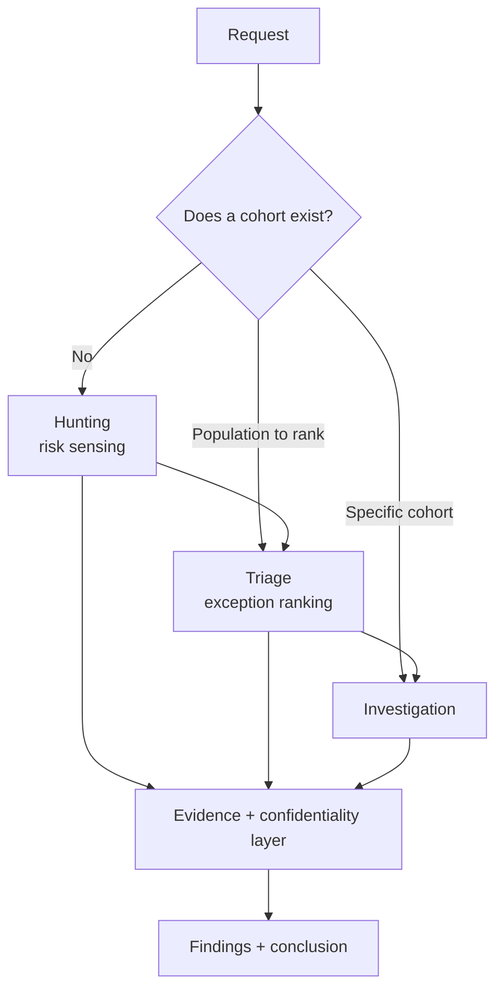

# Architecture

## Overview

`evidence-triage` is a Markdown-first agent skill. There is no runtime
service and no build step. The agent reads `SKILL.md`, works out which
phase the request belongs to, and loads the reference files it needs.

The repository has two layers:

1. **Methodology:** the three-phase model and its reference files.
2. **Audit layer:** evidence, findings, and confidentiality rules that
   make the output usable in an audit file.

## Components

| Component | Path | Job |
| --- | --- | --- |
| Router | `SKILL.md` | Classifies the phase, holds shared principles, lists references |
| Phase references | `references/hunting.md`, `triage.md`, `investigation.md` | Procedure and judgement rules for each phase |
| Linkage model | `references/linkage-attributes.md` | When a shared attribute justifies expanding a cluster |
| Typologies | `references/fraud-patterns.md` | Common patterns and the signals they produce |
| Output rules | `references/output-conventions.md` | Folder layout, slugs, artifact names |
| Evidence layer | `references/audit-evidence.md` | Sufficiency, relevance, reliability, workpapers, custody |
| Findings layer | `references/audit-findings.md` | Condition, criteria, cause, effect, recommendation |
| Confidentiality | `references/confidentiality.md` | Public-repo rules, redaction, private overlay |
| Audit reporting set | `references/audit-index.md` and the `audit-*.md` files | Engagement profile, evidence triage, claim testing, report design, drafting, review, release, public safety, templates |
| Validation | `scripts/validate_skill.py` | Frontmatter, reference table, assets, secret patterns |
| CI | `.github/workflows/ci.yml` | Markdown lint and skill validation |

## How a request moves through the skill



The router does not run a phase. It reads the request, asks one
clarifying question if the phase is ambiguous, and loads the matching
reference.

## When references load

- Hunting skims the library broadly.
- Triage reads its own reference and the linkage model.
- Investigation reads its own reference, the linkage model, and the
  evidence layer.
- Any phase that produces an artifact reads the confidentiality rules.
- Any phase that writes a conclusion reads the findings layer.

Every file under `references/` is listed in the `SKILL.md` table.
`scripts/validate_skill.py` fails when a file and the table drift
apart.

## Artifacts

A session writes to one folder:

```text
{workspace_root}/{YYYY-MM-DD}_{slug}/
├── data/
│   ├── 01_<slug>.sql
│   ├── 01_<slug>.csv
│   ├── 02_<slug>.sql
│   └── 02_<slug>.csv
└── investigation.md
```

Each query sits beside its numbered result file, ready to re-run. The
running document holds the hypotheses, the evidence, and the conclusion.

## Public and private

The public repo carries generic methodology, public frameworks, and
synthetic examples. Named signals, schema, thresholds, and past
incidents belong in a private overlay:

- a private repository, or
- a local folder excluded by `.gitignore`.

The public `SKILL.md` reference table must not name internal files. A
private wrapper skill or a local copy of `SKILL.md` points at the
overlay instead.

## Validation and CI

`.github/workflows/ci.yml` runs two jobs:

1. **Markdown lint:** style and structure across the repo.
2. **Skill validation:** frontmatter, skill name and version, reference
   table parity, required assets, and a secret-pattern scan.

The validation script uses only the Python standard library, so it runs
locally without installation.

## Design decisions

- **Markdown instead of code.** Markdown reads, diffs, and copies
  cleanly between Claude Code, Cowork, and Codex.
- **References over one long prompt.** Lazy loading keeps context small
  and lets each phase carry its own rules.
- **A generic public core.** The method is public; employer specifics
  stay in a private overlay.
- **A human conclusion.** The skill produces evidence and an argument.
  It leaves rating, sign-off, and remediation to the organization.

## Extension points

- Add a reference file and a row in `SKILL.md`.
- Add structural checks to the validation script.
- Add synthetic typologies that map to public audit concepts.
- Add translations that mirror `README.md`, keeping the English file as
  the source of truth.
